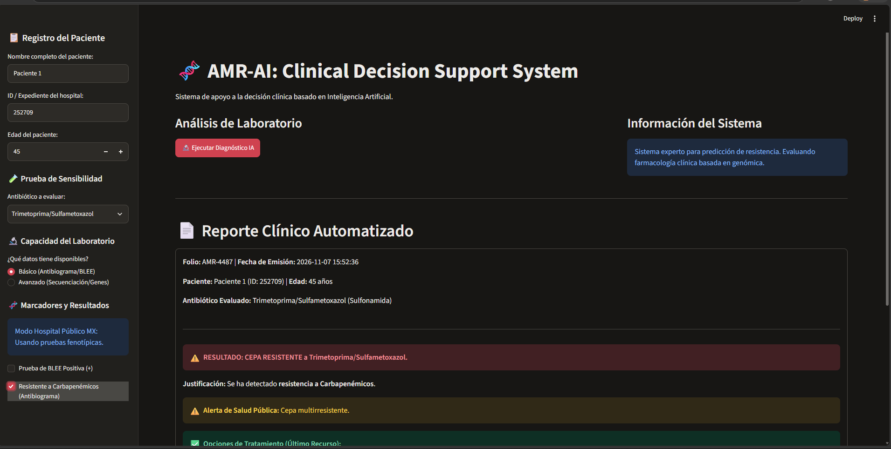
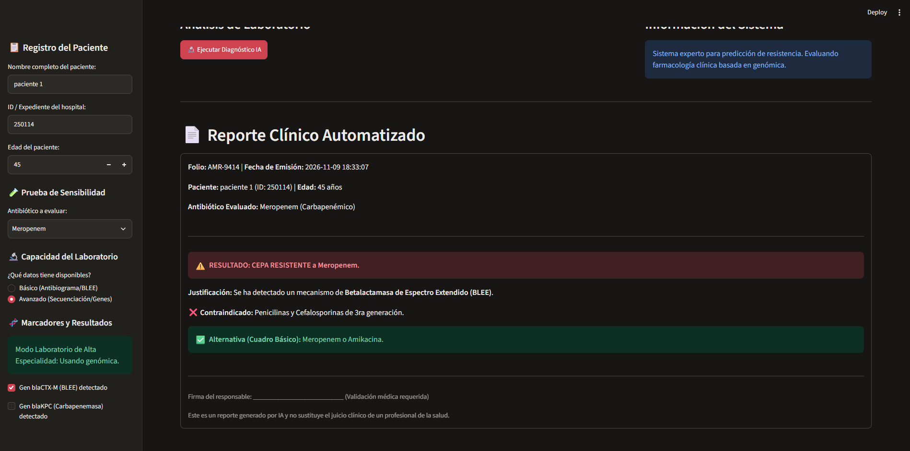
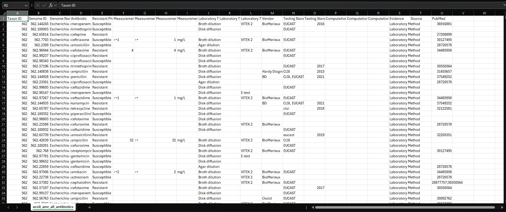
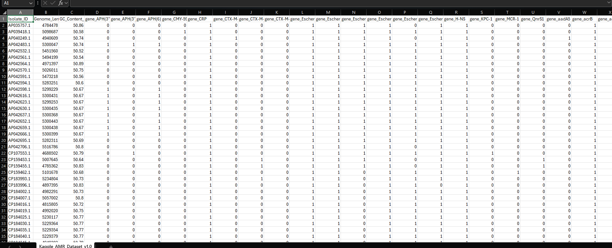

# 🧬 AMR-AI Clinical Web App (v2.0)

An advanced Clinical Decision Support System (CDSS) for Antimicrobial Resistance, featuring a **Dual-Model Architecture** that adapts to hospital infrastructure.

## 🚀 New Features (v2.0)
*   **Adaptive Design (Graceful Degradation):** The system detects the laboratory's capabilities and automatically routes the prediction.
    *   **Basic Mode:** Uses a Random Forest trained on 92,000+ phenotypic records (antibiograms/BLEE).
    *   **Advanced Mode:** Uses a Genomic Random Forest model trained on specific AMR genes (*blaCTX-M*, *blaKPC*).
*   **Automated Clinical Reports:** Generates printable medical reports with unique folios, timestamp, and hospital-specific formulary recommendations.
*   **Interactive Web UI:** Built with Streamlit for real-time antibiotic recommendations.

## 📸 Screenshots
**1. Basic Mode (Phenotypic)**

**2. Advanced Mode (Genomic)**

## 📊 Data Sources & Feature Engineering

To build a robust AI, the system was trained on two distinct real-world datasets, representing the two realities of clinical microbiology:

**1. Phenotypic Dataset (Basic Mode)**
*   **Source:** Kaggle (92,000+ clinical records).
*   **Features:** Laboratory results (e.g., Antibiotic tested, Resistant Phenotype).
*   **Objective:** Train the model to identify patterns based on standard antibiograms (Kirby-Bauer, BLEE tests) for hospitals without genomic sequencing capabilities.

**2. Genomic Dataset (Advanced Mode)**
*   **Source:** Kaggle Genomic AMR Dataset.
*   **Features:** Presence/absence of specific resistance genes (e.g., *blaCTX-M-15*, *blaKPC-1*).
*   **Objective:** Train a second model to predict resistance directly from the genetic profile (genotype-to-phenotype prediction) for high-resource laboratories.

## 🛠️ Technologies Used
*   Python 3, Streamlit
*   Scikit-Learn (Random Forest, Joblib)
*   Pandas, NumPy
